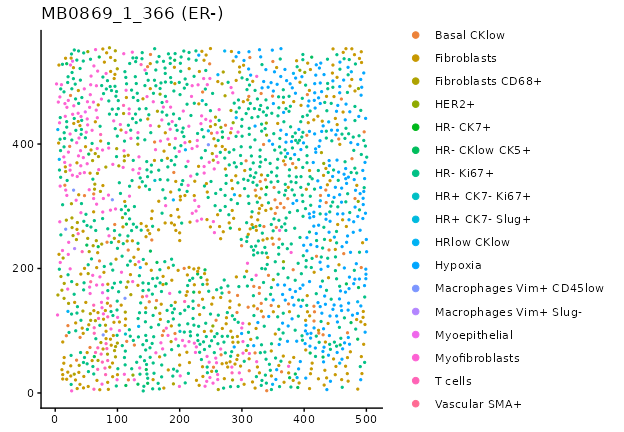
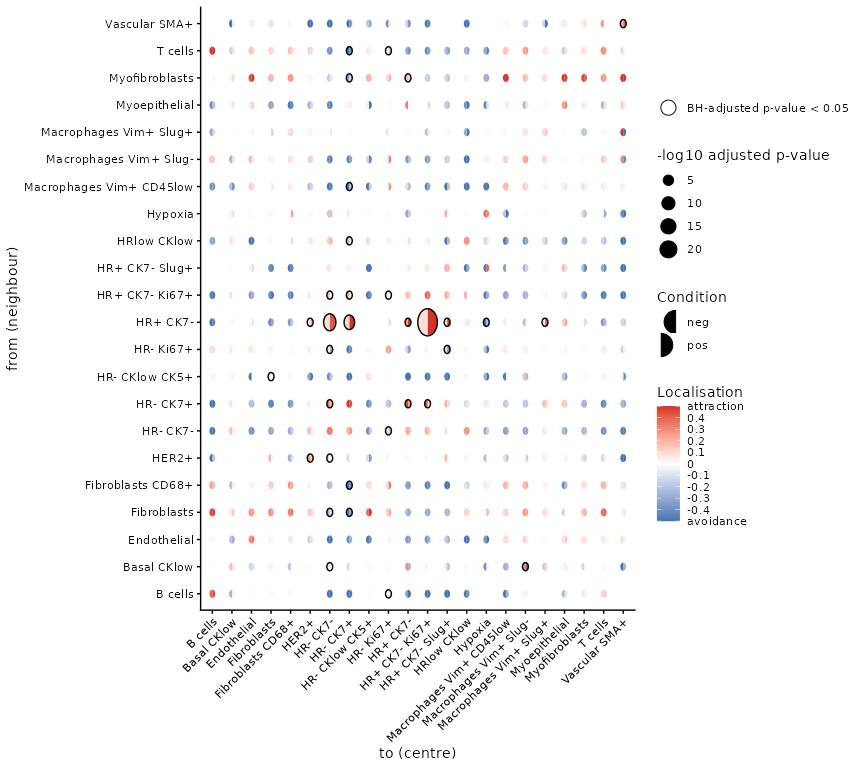
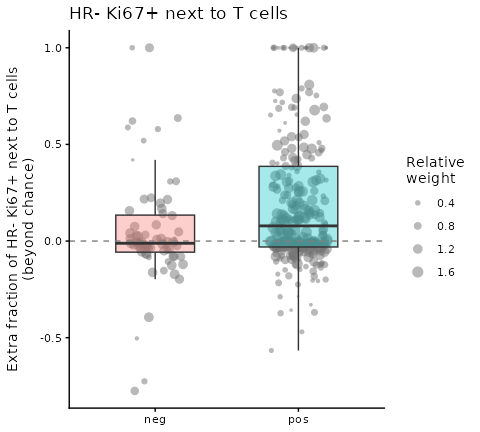
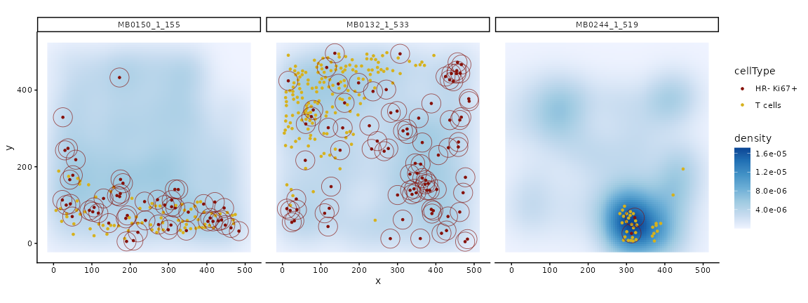
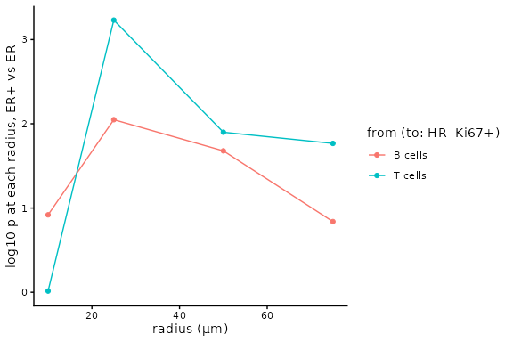
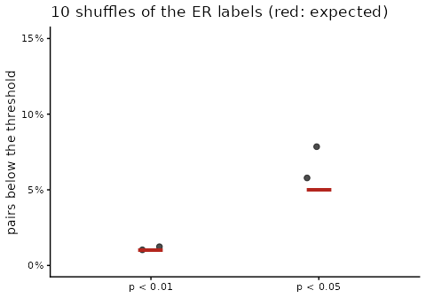

# Introduction to spicyR

Abstract

Do T cells gather around tumour cells more in ER-positive breast cancers
than in ER-negative ones? Do patients whose tumour cells are surrounded
by immune cells relapse later? spicyR answers questions like these for
every pair of cell types in an imaging study. This vignette works
through a study of 456 breast tumours: testing every pair, looking
closely at one, finding the images behind the result, and checking that
the test behaves when there is nothing to find.

## Introduction

A pair is written `from` → `to` and asks whether `to` cells are placed
near `from` cells more than other cells are. For each `to` cell, spicyR
checks whether there is a `from` cell within a radius, and compares the
share of `to` cells that have one with what we would expect if the `to`
cells were a random choice among the cells of the same image that are
not `from` cells. The effect is the **fraction of `to` cells placed next
to `from` cells**, beyond chance: 0.2 means as if a fifth of the `to`
cells had been moved next to `from` cells and the rest left where chance
would put them. For a pair whose `to` cells avoid the `from` cells
(fewer have one nearby than chance, over all images), the effect is
measured the other way: -0.2 means as if a fifth of the `to` cells that
chance would put next to a `from` cell had been moved away. Each `to`
cell counts once, however many `from` cells are beside it, so more
numerous or more tightly packed `from` cells do not inflate the effect.
Because the comparison uses only the cells that are actually there,
empty regions such as holes or air spaces, and uneven cell density, do
not by themselves create a signal (artefacts that affect one cell type
more than others are not removed). spicyR then compares the effect
between groups of patients, treating patients, not images or cells, as
the units of the test.

**Pairs are directional.** Tumour cells → T cells asks whether T cells
are placed near tumour cells (the extra fraction of T cells with a
tumour cell nearby), which is a different question from T cells → tumour
cells (are tumour cells placed near T cells?).

spicyR needs the type and position of every cell, as from imaging mass
cytometry, CODEX, MIBI, Xenium, CosMx or MERSCOPE; it is not designed
for spot-based data such as Visium.

Other Bioconductor packages also study how cell types are arranged.
*imcRtools* tests interactions between cell types within each image by
permutation, *spatialFDA* compares spatial summary functions between
samples with functional models, and *panoramic* compares a
co-localisation statistic across samples. spicyR is built for the
comparison between groups of patients: it measures co-localisation
against random labelling of the cells actually present, on a scale that
more numerous or more tightly packed cells do not inflate, treats
patients as the units, and uses a test designed to keep false positives
at the nominal rate with modest numbers of patients. It also relates
co-localisation to survival. It works alongside other SydneyBioX
packages: per-image statistics from *Statial* can be compared between
groups with spicyR’s image-level test, and *lisaClust* finds spatial
regions.


The pair T cells → proliferating tumour cells. For each proliferating
tumour cell (red, the `to` type), spicyR checks whether a T cell (blue,
the `from` type) lies within 25 µm, and compares the share of tumour
cells that have one with chance. Each patient gets an effect, and the
effect is compared between ER-negative and ER-positive tumours.

## Installation

spicyR 2.0, described here, is in the development version of
Bioconductor and will be in its next release. Install it with
BiocManager, using Bioconductor devel, or from GitHub:

``` r

if (!requireNamespace("BiocManager", quietly = TRUE)) install.packages("BiocManager")
BiocManager::install("spicyR", version = "devel")

# or, from GitHub
BiocManager::install("SydneyBioX/spicyR")
```

``` r

library(spicyR)
library(SpatialDatasets)
library(survival)
```

## The data

We use imaging mass cytometry of breast tumours from the METABRIC cohort
(Ali et al. 2020). Each of the 456 patients with known oestrogen
receptor (ER) status contributed one tumour core, and the authors
assigned each cell to one of 22 types. Their labels name tumour cells by
marker: HR is hormone receptor, CK cytokeratin, and Ki67+ marks
proliferating cells, so `HR- Ki67+` are proliferating
hormone-receptor-negative tumour cells. The data are a
`SpatialExperiment` in the SpatialDatasets package, with coordinates in
micrometres. The ER status of each patient is in `ER.Status`, `neg` or
`pos`; we keep the patients whose ER status is known.

``` r

spe <- spe_Ali_2020()
spe <- spe[, !is.na(spe$ER.Status)]   # the 456 patients with known ER status

# spicyR looks for columns called imageID and cellType by default. Copying the dataset's columns to these names is
# not needed (you can give imageID = "file_id", cellType = "description" to each call instead); it only keeps the
# calls below short.
spe$imageID <- spe$file_id
spe$cellType <- spe$description

sort(table(spe$cellType), decreasing = TRUE)
#> 
#>                 HR+ CK7-           Myofibroblasts              Fibroblasts 
#>                   114828                    57295                    49043 
#>                 HR- CK7-                 HR- CK7+              HRlow CKlow 
#>                    34951                    29432                    22824 
#>                  T cells           HR+ CK7- Ki67+        Fibroblasts CD68+ 
#>                    19218                    17203                    13716 
#>                HR- Ki67+           HR+ CK7- Slug+   Macrophages Vim+ Slug- 
#>                    13062                     7417                     6721 
#>                  Hypoxia            Myoepithelial                    HER2+ 
#>                     5639                     4637                     4434 
#>   Macrophages Vim+ Slug+ Macrophages Vim+ CD45low              Endothelial 
#>                     3657                     3600                     3480 
#>                  B cells              Basal CKlow            Vascular SMA+ 
#>                     3232                     3226                     2908 
#>           HR- CKlow CK5+ 
#>                     2106
```

Two of the cores, one ER− and one ER+:

``` r

plotImage(spe, c("MB0869_1_366", "MB0501_1_222"))
```



## Testing every pair of cell types

[`spicy()`](https://sydneybiox.github.io/spicyR/dev/reference/spicy.md)
needs the column of the condition, the column of the patient (`subject`)
and a radius. It accepts a `SpatialExperiment`, a `SingleCellExperiment`
or a `data.frame` with one row per cell. By default it looks for columns
called `imageID` and `cellType`, which we set above. The coordinates of
a `SpatialExperiment` are taken from
[`spatialCoords()`](https://rdrr.io/pkg/SpatialExperiment/man/SpatialExperiment-methods.html).

**Choosing the radius.** Choose it before looking at the results, from
the scale at which you expect cells to interact: 10 to 25 µm for
contact, 50 to 100 µm for a shared neighbourhood. Here we use 25 µm,
about two to three cell diameters. If you are unsure, give several radii
(see [Which radius?](#which-radius)).

``` r

res <- spicy(spe, condition = "ER.Status", subject = "metabricId", r = 25)
res
#> spicyR (cell-level test): 484 pairs, pos vs neg, r = 25
#> Units: 456 patients (neg 83, pos 373) with 456 images
#> 13 pairs are not tested (p_value NA: no variation, a condition with no informative patient, or one with too few effective patients)
#> BH-adjusted p < 0.05: 33 pairs
#> See topPairs().
```

All 484 ordered pairs of cell types are tested, in a few seconds on one
core; run time and memory grow roughly in proportion to the number of
cells and to the radius.
[`topPairs()`](https://sydneybiox.github.io/spicyR/dev/reference/topPairs.md)
lists the most significant. `excess_ref` and `excess_comp` are the
average effect in ER− and in ER+ patients, as a fraction of the `to`
cells, and `excess_difference` is their difference (ER+ minus ER−).
P-values are adjusted across all pairs by the Benjamini–Hochberg method.

``` r

topPairs(res, n = 8)
#>                                            from                     to
#> HR+ CK7-__HR+ CK7- Ki67+               HR+ CK7-         HR+ CK7- Ki67+
#> HR+ CK7-__HR- CK7-                     HR+ CK7-               HR- CK7-
#> HR+ CK7-__HR- CK7+                     HR+ CK7-               HR- CK7+
#> HR+ CK7-__HR+ CK7- Slug+               HR+ CK7-         HR+ CK7- Slug+
#> HR+ CK7-__Macrophages Vim+ Slug+       HR+ CK7- Macrophages Vim+ Slug+
#> HR+ CK7- Ki67+__HR- CK7+         HR+ CK7- Ki67+               HR- CK7+
#> HR- CK7+__HR+ CK7- Ki67+               HR- CK7+         HR+ CK7- Ki67+
#> HR+ CK7-__HR+ CK7-                     HR+ CK7-               HR+ CK7-
#>                                  excess_ref excess_comp excess_difference
#> HR+ CK7-__HR+ CK7- Ki67+         0.08816437  0.63977063         0.5516063
#> HR+ CK7-__HR- CK7-               0.08717957  0.42661842         0.3394389
#> HR+ CK7-__HR- CK7+               0.10713337  0.49640085         0.3892675
#> HR+ CK7-__HR+ CK7- Slug+         0.05632972  0.55049941         0.4941697
#> HR+ CK7-__Macrophages Vim+ Slug+ 0.05321105  0.36643911         0.3132281
#> HR+ CK7- Ki67+__HR- CK7+         0.24029870  0.02524918        -0.2150495
#> HR- CK7+__HR+ CK7- Ki67+         0.42114341  0.08618614        -0.3349573
#> HR+ CK7-__HR+ CK7-               0.24542959  0.55082550         0.3053959
#>                                       p_value        p_adj
#> HR+ CK7-__HR+ CK7- Ki67+         2.450417e-26 1.154146e-23
#> HR+ CK7-__HR- CK7-               1.919165e-17 4.519634e-15
#> HR+ CK7-__HR- CK7+               3.161955e-15 4.964269e-13
#> HR+ CK7-__HR+ CK7- Slug+         5.723759e-09 6.739726e-07
#> HR+ CK7-__Macrophages Vim+ Slug+ 1.111567e-08 1.047097e-06
#> HR+ CK7- Ki67+__HR- CK7+         1.432717e-08 1.124683e-06
#> HR- CK7+__HR+ CK7- Ki67+         2.719414e-08 1.829777e-06
#> HR+ CK7-__HR+ CK7-               5.858613e-08 3.449258e-06
```

Most of these pairs have `HR+ CK7-` tumour cells as the `from` or the
`to` type, the most significant as the `from` type; we come back to them
in [Tissue compartments](#tissue-compartments).

`topPairs(res, n = NULL)` lists every pair, and `from` and `to` choose
pairs. Its columns:

| Column | Meaning |
|----|----|
| `excess_ref`, `excess_comp` | average effect in the reference group (ER−) and the comparison group (ER+) |
| `excess_difference` | their difference |
| `p_value`, `p_adj` | p-value (NA where the pair is not tested), and Benjamini–Hochberg adjusted p-value across all pairs |
| `<covariate>_effect`, `<covariate>_p_value` | with covariates, the effect of each covariate and its p-value |

With more than two groups there is one row per pair and group, each
compared with the reference group, in a column `level`.

## Seeing every pair at once

[`signifPlot()`](https://sydneybiox.github.io/spicyR/dev/reference/signifPlot.md)
shows the whole study. Read rows as `from` and columns as `to`. Each
circle is a pair: the left half is coloured by the effect in ER− tumours
and the right half by the effect in ER+ tumours (red: more `to` cells
next to `from` cells than chance, blue: fewer), the size reflects the
p-value, and a black ring marks a BH-adjusted p-value below 0.05.

``` r

signifPlot(res, fdr = TRUE, breaks = c(-0.5, 0.5, 0.1))
```



## Looking at one pair

We focus on an immune pair, T cells → `HR- Ki67+`: are proliferating
hormone-receptor-negative tumour cells placed near T cells? Its effect
is the extra fraction of these tumour cells with a T cell within 25 µm.

``` r

onePair <- topPairs(res, from = "T cells", to = "HR- Ki67+")
onePair
#>                       from        to excess_ref excess_comp excess_difference
#> T cells__HR- Ki67+ T cells HR- Ki67+ 0.02863777   0.1434333         0.1147955
#>                         p_value     p_adj
#> T cells__HR- Ki67+ 0.0007110759 0.0176272
```

In ER− tumours these tumour cells have a T cell nearby barely more often
than chance would give (0.03). In ER+ tumours the effect is 0.14, as if
about one in 7 of them had been placed next to T cells.

[`spicyBoxPlot()`](https://sydneybiox.github.io/spicyR/dev/reference/spicyBoxPlot.md)
shows the effect in each image (here one image per patient), with a
point per image behind each box. Points are sized by how much the image
contributes to the test.

``` r

spicyBoxPlot(res, from = "T cells", to = "HR- Ki67+")
```



With `interactive = TRUE` the plot is a plotly widget: hover over a
point to see which image it is. (It is shown on the [package
website](https://sydneybiox.github.io/spicyR/dev/articles/spicyR.html);
it is left out of the vignette installed with the package to keep it
small.)

``` r

spicyBoxPlot(res, from = "T cells", to = "HR- Ki67+", interactive = TRUE)
```

This is an association in one cohort; it does not show that T cells
attract the tumour cells, or the reverse.

[`bind()`](https://sydneybiox.github.io/spicyR/dev/reference/bind.md)
returns the per-image values as a table, for your own plots or models.
Images without any `HR- Ki67+` cells carry no information about the pair
(`NA`).

``` r

head(bind(res, from = "T cells", to = "HR- Ki67+"))
#>                   imageID condition subject      effect      weight
#> MB0000_1_527 MB0000_1_527       pos MB-0000          NA          NA
#> MB0002_1_345 MB0002_1_345       pos MB-0002 -0.01092896 0.006077676
#> MB0005_1_211 MB0005_1_211       pos MB-0005 -0.01305970 0.006217612
#> MB0010_1_420 MB0010_1_420       pos MB-0010  0.25661632 0.006037744
#> MB0013_1_371 MB0013_1_371       pos MB-0013          NA          NA
#> MB0014_1_326 MB0014_1_326       pos MB-0014  0.48000000 0.002896395
```

## Looking at the images

[`plotImage()`](https://sydneybiox.github.io/spicyR/dev/reference/plotImage.md)
shows images: the density of all cells in blue, the `from` cells in gold
and the `to` cells in dark red. With `r`, it draws the circle around
each `to` cell inside which spicyR looks for `from` cells. We look at
three images found with the interactive box plot.
[`bind()`](https://sydneybiox.github.io/spicyR/dev/reference/bind.md)
has their effects and weights, with the images as row names.

``` r

examples <- c("MB0150_1_155", "MB0132_1_533", "MB0244_1_519")
ex <- bind(res, from = "T cells", to = "HR- Ki67+")[examples, ]
ex
#>                   imageID condition subject      effect      weight
#> MB0150_1_155 MB0150_1_155       pos MB-0150  0.67741935 0.006093785
#> MB0132_1_533 MB0132_1_533       neg MB-0132 -0.07907636 0.017521404
#> MB0244_1_519 MB0244_1_519       pos MB-0244  1.00000000 0.001109917
```

``` r

plotImage(spe, examples, from = "T cells", to = "HR- Ki67+", r = 25)
```



In the ER+ image on the left, the T cells run along the band of tumour
cells at the bottom: an effect of 0.68, as if that fraction of the
tumour cells had been placed next to T cells. In the ER− image in the
middle, the T cells are concentrated top left, apart from most of the
tumour cells, and slightly fewer tumour cells have a T cell nearby than
chance would give (-0.08). The ER+ image on the right reaches the
largest possible value, 1, but only because its two tumour cells both
happen to sit in a cluster of T cells.

**Point size matters.** The right-hand image sits at the top of the box
plot, but its weight is close to zero: an effect estimated from two
cells says little. Weights also level off. Once an image has a few dozen
`to` cells, more cells add little, because the differences between
patients outweigh the noise within an image.

## Tissue compartments

Many of the most significant pairs, the first among them, have
`HR+ CK7-` tumour cells as the `from` type. These cells make up about a
quarter of the cells in a typical ER+ core and almost none in ER− cores.
In ER+ tumours they make up much of the tumour tissue and the other
tumour cells sit among them, so far more of those cells have an
`HR+ CK7-` cell nearby than if they had been placed at random among all
the other cells, stroma included.

``` r

topPairs(res, from = "HR+ CK7-", n = 6)
#>                                      from                     to excess_ref
#> HR+ CK7-__HR+ CK7- Ki67+         HR+ CK7-         HR+ CK7- Ki67+ 0.08816437
#> HR+ CK7-__HR- CK7-               HR+ CK7-               HR- CK7- 0.08717957
#> HR+ CK7-__HR- CK7+               HR+ CK7-               HR- CK7+ 0.10713337
#> HR+ CK7-__HR+ CK7- Slug+         HR+ CK7-         HR+ CK7- Slug+ 0.05632972
#> HR+ CK7-__Macrophages Vim+ Slug+ HR+ CK7- Macrophages Vim+ Slug+ 0.05321105
#> HR+ CK7-__HR+ CK7-               HR+ CK7-               HR+ CK7- 0.24542959
#>                                  excess_comp excess_difference      p_value
#> HR+ CK7-__HR+ CK7- Ki67+           0.6397706         0.5516063 2.450417e-26
#> HR+ CK7-__HR- CK7-                 0.4266184         0.3394389 1.919165e-17
#> HR+ CK7-__HR- CK7+                 0.4964008         0.3892675 3.161955e-15
#> HR+ CK7-__HR+ CK7- Slug+           0.5504994         0.4941697 5.723759e-09
#> HR+ CK7-__Macrophages Vim+ Slug+   0.3664391         0.3132281 1.111567e-08
#> HR+ CK7-__HR+ CK7-                 0.5508255         0.3053959 5.858613e-08
#>                                         p_adj
#> HR+ CK7-__HR+ CK7- Ki67+         1.154146e-23
#> HR+ CK7-__HR- CK7-               4.519634e-15
#> HR+ CK7-__HR- CK7+               4.964269e-13
#> HR+ CK7-__HR+ CK7- Slug+         6.739726e-07
#> HR+ CK7-__Macrophages Vim+ Slug+ 1.047097e-06
#> HR+ CK7-__HR+ CK7-               3.449258e-06
ki67 <- topPairs(res, from = "HR+ CK7-", to = "HR+ CK7- Ki67+")
```

In ER+ tumours the effect for proliferating `HR+ CK7- Ki67+` cells is
0.64, against 0.09 in ER− tumours, while fibroblasts and T cells are
placed away from `HR+ CK7-` cells (where `HR+ CK7-` cells are rare, as
in ER− cores, an effect cannot fall far below zero). These are real
differences in arrangement, but they describe the structure of the
tissue (tumour cells sit with tumour cells) more than an interaction
between particular cell types.

To ask about arrangement within a compartment, for example whether
proliferating tumour cells sit closer to `HR+ CK7-` cells than other
tumour cells do, compare with random labelling among the tumour cells
only. The Kontextual test in the *Statial* package does this.

## Allocation or count?

By default spicyR asks whether each `to` cell has a `from` cell nearby.
With `effect = "count"` it asks how many: the effect is then the number
of extra `from` cells within the radius of each `to` cell.

``` r

resCount <- spicy(spe, condition = "ER.Status", subject = "metabricId", r = 25, effect = "count")
onePairCount <- topPairs(resCount, from = "T cells", to = "HR- Ki67+")
onePairCount
#>                       from        to excess_ref excess_comp excess_difference
#> T cells__HR- Ki67+ T cells HR- Ki67+ 0.04385209    0.291235          0.247383
#>                         p_value       p_adj
#> T cells__HR- Ki67+ 6.653874e-05 0.001505043
```

In ER+ tumours each proliferating tumour cell has about 0.29 extra T
cells within 25 µm, against 0.04 in ER− tumours. The count also reflects
how many T cells surround each tumour cell, but it grows with how
tightly the `from` cells are packed: if T cells form denser clusters in
one group, each tumour cell next to a cluster counts more T cells. The
default effect counts each tumour cell once, however many T cells are
beside it, so denser clusters do not inflate it.

Use the default when your question is whether `to` cells are placed next
to `from` cells. Use `effect = "count"` when the number of `from` cells
around each `to` cell is the question, keeping in mind that it also
rises when the `from` cells are packed more tightly.
`adjustAbundance = TRUE` adds the log share of the `from` type in each
image to the model, so that groups are compared at the same abundance;
it does not account for how tightly the `from` cells are packed, and
when that share differs strongly between groups, as for `HR+ CK7-` here,
it leaves little power.

## Patients with several images

Each METABRIC patient has one core. When patients contribute several
images, give the patient column as `subject`: the images of each patient
are combined, and patients remain the units of the test. The package’s
`diabetesData` has 10 images from each of 12 pancreas donors (Damond et
al. 2019); here we compare the 4 donors at the onset of type 1 diabetes
with the 4 non-diabetic donors.

``` r

data("diabetesData")
diabetes <- diabetesData[, diabetesData$stage %in% c("Non-diabetic", "Onset")]
resDonors <- spicy(diabetes, condition = "stage", subject = "case", r = 50)
resDonors
#> spicyR (cell-level test): 256 pairs, Onset vs Non-diabetic, r = 50
#> Units: 8 patients (Non-diabetic 4, Onset 4) with 80 images
#> 74 pairs are not tested (p_value NA: no variation, a condition with no informative patient, or one with too few effective patients)
#> BH-adjusted p < 0.05: 0 pairs
#> See topPairs().
```

No pair is significant with the 8 donors as the units. Leaving out
`subject` treats each of the 80 images as a separate patient:

``` r

resImages <- spicy(diabetes, condition = "stage", r = 50)
resImages
#> spicyR (cell-level test): 256 pairs, Onset vs Non-diabetic, r = 50
#> Units: 80 images (Non-diabetic 40, Onset 40); no subject given: each image is a patient
#> 68 pairs are not tested (p_value NA: no variation, a condition with no informative patient, or one with too few effective patients)
#> BH-adjusted p < 0.05: 7 pairs
#> See topPairs().
```

Treating every image as an independent patient overstates the evidence:
images from one donor are alike, and here it turns up 7 pairs that the
donors do not support. Always give `subject` when patients have several
images.

## Adjusting for clinical covariates

Covariates measured per patient or per image are added with
`covariates`. Here we also adjust the ER comparison for age at diagnosis
and tumour grade.

``` r

spe$Grade <- factor(spe$Grade)
resCov <- spicy(spe, condition = "ER.Status", subject = "metabricId", r = 25,
                covariates = c("Age.At.Diagnosis", "Grade"))
resCov
#> spicyR (cell-level test): 484 pairs, pos vs neg, r = 25
#> Units: 456 patients (neg 83, pos 373) with 456 images
#> Adjusted for: covariates (unadjusted test in the unadjusted_* columns)
#> 50 pairs could not be adjusted and are reported unadjusted (see adjusted_for)
#> 1 pairs have a condition with no informative patient (adjusted_for "none (no_information)") and are not tested
#> 5 pairs have a condition with too few effective patients (adjusted_for "none (few_effective_units)") and are not tested
#> BH-adjusted p < 0.05: 25 pairs (33 without adjustment)
#> See topPairs().
```

The main columns (`excess_difference`, `p_value`, `p_adj`) are now the
ER comparison adjusted for age and grade. Each covariate also has its
own effect and p-value. A factor has one per level after the first:
`Grade2` and `Grade3` compare grades 2 and 3 with grade 1.

``` r

covPair <- topPairs(resCov, from = "T cells", to = "HR- Ki67+")
covPair
#>                       from        to excess_ref excess_comp excess_difference
#> T cells__HR- Ki67+ T cells HR- Ki67+ 0.03084789   0.1444961         0.1136482
#>                       p_value      p_adj Age.At.Diagnosis_effect
#> T cells__HR- Ki67+ 0.00136956 0.03583682             0.001465371
#>                    Age.At.Diagnosis_p_value Grade2_effect Grade2_p_value
#> T cells__HR- Ki67+               0.09498925   -0.04769688      0.5794419
#>                    Grade3_effect Grade3_p_value
#> T cells__HR- Ki67+   -0.04183543      0.6239747
```

The difference between ER+ and ER− patients is much the same after
adjusting for age and grade, and neither has a clear effect of its own
on this pair. Patients with a missing covariate are left out of the
adjusted test.

A pair that cannot be adjusted, for example because its cell types
appear in images of only one grade, is reported unadjusted. The printed
summary above counts these pairs.

Restricting `from` and `to` does not change the results for the pairs
that are tested.

## Which radius?

The scale of an interaction is rarely known in advance. Give several
radii and spicyR tests them together, using a max-T test that accounts
for the strong correlation between neighbouring radii. The exact max-T
handles up to six radii; for a finer grid, such as every 2 µm up to 50
µm, `combine = "davies"` uses the bound of Davies (1987) for the maximum
over a smooth range of radii, which stays close to the exact max-T when
neighbouring radii are highly correlated. `combine = "cauchy"`, the
Cauchy combination of Liu and Xie (2020), is another alternative.

``` r

resR <- spicy(spe, condition = "ER.Status", subject = "metabricId", r = c(10, 25, 50, 75))
topPairs(resR, from = c("T cells", "B cells"), to = "HR- Ki67+")
#>                       from        to  r  excess_ref excess_comp
#> T cells__HR- Ki67+ T cells HR- Ki67+ 10 -0.22433417   0.9452872
#> B cells__HR- Ki67+ B cells HR- Ki67+ 50 -0.07222817   0.3471500
#>                    excess_difference      p_value        p_adj
#> T cells__HR- Ki67+         1.1696214 5.909962e-09 5.720843e-07
#> B cells__HR- Ki67+         0.4193782 3.247922e-03 5.239981e-02
```

`r` is the radius with the strongest evidence, and `p_value` the
combined p-value over all radii.
[`radiusPlot()`](https://sydneybiox.github.io/spicyR/dev/reference/radiusPlot.md)
shows the evidence at each radius.

The effect depends on the radius: at a larger radius more cells have a
`from` cell nearby by chance, and the effect describes placement at that
scale. Where most cells have a `from` cell nearby by chance, there is
little room for an effect and it is noisy. Compare p-values across radii
rather than the size of the effect. The effect at the chosen radius is a
little optimistic, because that radius was picked for its strength.

``` r

radiusPlot(resR, from = c("T cells", "B cells"), to = "HR- Ki67+")
```



## Is co-localisation associated with survival?

With a `Surv` column as the condition, spicyR asks whether a patient’s
effect is associated with their outcome. Here we use relapse-free
survival, adjusting for age.

``` r

spe$RFS <- Surv(spe$timeRFS, spe$eventRFS)
resS <- spicy(spe, condition = "RFS", subject = "metabricId", r = 25, covariates = "Age.At.Diagnosis")
resS
#> spicyR (cell-level test): 481 pairs, association with survival, r = 25
#> Units: 456 patients with 456 images
#> Adjusted for: covariates
#> BH-adjusted p < 0.05: 3 pairs
#> See topPairs().
topPairs(resS, n = 6)
#>                                                             from
#> HR+ CK7-__HR- CK7+                                      HR+ CK7-
#> HR+ CK7-__HR+ CK7- Ki67+                                HR+ CK7-
#> HRlow CKlow__HR- CK7+                                HRlow CKlow
#> Macrophages Vim+ CD45low__Myoepithelial Macrophages Vim+ CD45low
#> HR- CK7+__HRlow CKlow                                   HR- CK7+
#> Myoepithelial__Macrophages Vim+ CD45low            Myoepithelial
#>                                                               to
#> HR+ CK7-__HR- CK7+                                      HR- CK7+
#> HR+ CK7-__HR+ CK7- Ki67+                          HR+ CK7- Ki67+
#> HRlow CKlow__HR- CK7+                                   HR- CK7+
#> Macrophages Vim+ CD45low__Myoepithelial            Myoepithelial
#> HR- CK7+__HRlow CKlow                                HRlow CKlow
#> Myoepithelial__Macrophages Vim+ CD45low Macrophages Vim+ CD45low
#>                                         hazard_ratio_sd      p_value
#> HR+ CK7-__HR- CK7+                            0.6145379 9.146473e-06
#> HR+ CK7-__HR+ CK7- Ki67+                      0.6672860 2.031705e-05
#> HRlow CKlow__HR- CK7+                         0.6489038 1.560286e-04
#> Macrophages Vim+ CD45low__Myoepithelial       0.6467204 1.121743e-03
#> HR- CK7+__HRlow CKlow                         0.7310882 1.261833e-03
#> Myoepithelial__Macrophages Vim+ CD45low       0.6706243 1.568620e-03
#>                                               p_adj
#> HR+ CK7-__HR- CK7+                      0.004399453
#> HR+ CK7-__HR+ CK7- Ki67+                0.004886250
#> HRlow CKlow__HR- CK7+                   0.025016580
#> Macrophages Vim+ CD45low__Myoepithelial 0.121388361
#> HR- CK7+__HRlow CKlow                   0.121388361
#> Myoepithelial__Macrophages Vim+ CD45low 0.125751045
```

The p-value comes from a score test that relates each patient’s effect
to their outcome. `hazard_ratio_sd` is the hazard ratio for a one
standard deviation higher effect, from a Cox model; below one, patients
with a higher effect had a lower risk of relapse. It is missing when the
effect barely varies between patients.

3 pairs are significant after adjusting for multiple testing. The two
strongest have `HR+ CK7-` tumour cells as the `from` type: patients in
whom more of the other tumour cells sat next to `HR+ CK7-` cells
relapsed later. These cells are typical of ER+ tumours, and ER status is
itself related to relapse, so we add it to the covariates.

``` r

resSER <- spicy(spe, condition = "RFS", subject = "metabricId", r = 25, covariates = c("Age.At.Diagnosis", "ER.Status"))
resSER
#> spicyR (cell-level test): 481 pairs, association with survival, r = 25
#> Units: 456 patients with 456 images
#> Adjusted for: covariates
#> BH-adjusted p < 0.05: 0 pairs
#> See topPairs().
```

No pair remains significant: these pairs say little about relapse beyond
the tumour’s ER status.

## A check you can run

A test should give few significant results when there is nothing to
find. Shuffling the ER labels across patients removes any real
difference, so about 5% of pairs should then have p \< 0.05, and about
1% p \< 0.01.
[`calibrationCheck()`](https://sydneybiox.github.io/spicyR/dev/reference/calibrationCheck.md)
shuffles the condition and runs
[`spicy()`](https://sydneybiox.github.io/spicyR/dev/reference/spicy.md)
with the same arguments, ten times by default.
[`summary()`](https://rdrr.io/r/base/summary.html) averages the shuffles
and [`plot()`](https://rdrr.io/r/graphics/plot.default.html) shows each
of them.

``` r

set.seed(2026)
shuffles <- calibrationCheck(spe, condition = "ER.Status", subject = "metabricId", r = 25)
calibration <- summary(shuffles)
calibration
#>   threshold expected  percent
#> 1      0.05        5 4.801519
#> 2      0.01        1 1.027966
```

``` r

plot(shuffles)
```



On average 4.8% of pairs have p \< 0.05 and 1% have p \< 0.01, close to
the expected 5% and 1%. Pairs share cells, so the percentage moves by a
few points from one shuffle to the next.

Run this check on your own data before trusting a discovery. It takes a
few minutes and shows whether the test is calibrated for your study
design.

## How it works

For a pair `from` → `to` and an image, let *O* be the number of `to`
cells with at least one `from` cell within *r*, out of *n* `to` cells.
If the `to` cells were a random choice among the cells of the image that
are not `from` cells, keeping every cell where it is, *O* would have an
exact mean and variance, which spicyR computes without permutations. The
effect of an image is

``` math
\delta = \frac{O - \mathrm{E}_{\mathrm{RL}}(O)}{n - \mathrm{E}_{\mathrm{RL}}(O)},
```

where $`\mathrm{E}_{\mathrm{RL}}(O)`$ is that expectation under random
labelling. If a fraction *f* of the `to` cells were placed next to
`from` cells and the rest at random, δ would estimate *f*. At radius
*r*, *O*/*n* is the cross-type nearest-neighbour distribution function
*G* of spatial statistics, and δ compares it with random labelling, much
as the J function compares *G* with the empty-space function (van
Lieshout and Baddeley 1996). Negative values mean fewer `to` cells next
to `from` cells than chance; they are not a fraction, and the lowest
possible value,
$`-\mathrm{E}_{\mathrm{RL}}(O)/(n - \mathrm{E}_{\mathrm{RL}}(O))`$, is
far below zero only where `from` cells are common. With
`effect = "count"`, *O* is instead the sum, over the `to` cells, of the
number of `from` cells within *r* of each, and the denominator is *n*,
an analogue of Ripley’s K function.

Images from the same patient are combined, giving more weight to more
informative images (usually those with more `to` cells), up to a limit:
a patient’s images can differ in their true effect, by an amount
estimated from the spread between each patient’s images (DerSimonian and
Laird 1986), so one large image cannot outweigh the patient’s other
images. Each patient has its own true effect, which varies around its
group’s mean by an amount estimated from the data (a frailty, or
random-effects, model, with the between-patient variance estimated as by
Paule and Mandel (1982)). The difference between groups, adjusted for
any covariates, is tested on Satterthwaite degrees of freedom with
patients as the clusters, using the small-sample cluster-robust (CR2)
variance (Bell and McCaffrey 2002; Pustejovsky and Tipton 2018). Each
group contributes its own CR2 variance. For a self-pair (`from` the same
as `to`), whose cells and neighbours are both moved by random labelling,
the variance is the random-labelling variance of the self-pair. For the
allocation effect with a radius, the neighbours shared by nearby cells
are counted from 50 randomly chosen cells of each image
(`selfVarianceCells`) and scaled up, an unbiased and reproducible
estimate that keeps large radii fast; `selfVariance = "exact"` counts
them for every cell. With the allocation effect, an image whose room on
the pair’s side is below one cell is not used. A radius where a group’s
effective patients fall below the smaller of three and half its patients
at that radius, because a few patients carry nearly all of its weight,
is not tested. This is designed to keep false positives near the nominal
rate even with modest numbers of patients. A paper describing the method
is in preparation.

## Small studies

With fewer than about ten patients per group, expect few significant
pairs, even when an effect is consistent across patients: a calibrated
test cannot be confident with little information. A group needs at least
three patients, and in practice a few more, since patients rarely carry
equal weight. Look at whether the patients agree in direction with
[`spicyBoxPlot()`](https://sydneybiox.github.io/spicyR/dev/reference/spicyBoxPlot.md).

`variance = "hartung_knapp"` (Hartung and Knapp 2001) can give more
power in very small studies, but it can give too many small p-values for
rare cell types, so it is not the default.

## Reporting results

A methods sentence might read: “We used spicyR (version 1.99.52) to
test, for every ordered pair of cell types, whether the fraction of `to`
cells with at least one `from` cell within 25 µm, relative to random
labelling of the cells in each image, differed between ER+ and ER−
patients, with patients as the units of analysis. P-values were adjusted
across pairs by the Benjamini–Hochberg method.” Show a per-patient plot
([`spicyBoxPlot()`](https://sydneybiox.github.io/spicyR/dev/reference/spicyBoxPlot.md))
and an image of the pair
([`plotImage()`](https://sydneybiox.github.io/spicyR/dev/reference/plotImage.md))
alongside the p-value.

``` r

citation("spicyR")
#> To cite spicyR in publications please use:
#> 
#>   Canete N, Iyengar S, Ormerod J, Baharlou H, Harman A, Patrick E
#>   (2022). "spicyR: spatial analysis of in situ cytometry data in R."
#>   _Bioinformatics_, *38*(11), 3099-3105.
#>   doi:10.1093/bioinformatics/btac268
#>   <https://doi.org/10.1093/bioinformatics/btac268>.
#> 
#> A BibTeX entry for LaTeX users is
#> 
#>   @Article{,
#>     title = {{spicyR: spatial analysis of in situ cytometry data in R}},
#>     author = {Nicolas Canete and Sourish Iyengar and John Ormerod and Heeva Baharlou and Andrew Harman and Ellis Patrick},
#>     year = {2022},
#>     volume = {38},
#>     number = {11},
#>     pages = {3099--3105},
#>     journal = {Bioinformatics},
#>     doi = {10.1093/bioinformatics/btac268},
#>   }
```

## Coming from spicyR 1.x

spicyR 2.0 changes the default test. Before 2.0,
[`spicy()`](https://sydneybiox.github.io/spicyR/dev/reference/spicy.md)
compared a per-image summary of the L-function between groups with a
weighted mixed model (Canete et al. 2022). That test is still available,
and gives the same results as before, with `method = "image"`; it is
described in the vignette “The original image-level test in spicyR”. It
is also the method to use with your own per-image statistics
(`alternateResult`), for example from the Statial package.
[`topPairs()`](https://sydneybiox.github.io/spicyR/dev/reference/topPairs.md),
[`signifPlot()`](https://sydneybiox.github.io/spicyR/dev/reference/signifPlot.md),
[`spicyBoxPlot()`](https://sydneybiox.github.io/spicyR/dev/reference/spicyBoxPlot.md)
and
[`bind()`](https://sydneybiox.github.io/spicyR/dev/reference/bind.md)
work with both tests. For the image-level test,
[`topPairs()`](https://sydneybiox.github.io/spicyR/dev/reference/topPairs.md)
reports `intercept`, `coefficient`, `p.value` and `adj.pvalue` as
before; for the cell-level test it reports the effects and p-values
described above.

``` r

resImage <- spicy(spe, condition = "ER.Status", subject = "metabricId", method = "image",
                  from = "T cells", to = "HR- Ki67+")
topPairs(resImage)
#>                    intercept coefficient   p.value adj.pvalue    from        to
#> T cells__HR- Ki67+  3.722601   -6.981016 0.3419058  0.3419058 T cells HR- Ki67+
```

The image-level test summarises a different statistic, on a different
scale, so its coefficient is not comparable with the cell-level effect;
here it finds no evidence of a difference either way.

## Python

The Python package [spicyr](https://sydneybiox.github.io/spicyr-py) runs
the same cell-level test on AnnData, SpatialData and pandas objects, on
the same C++ code, and gives the same results; its tutorial is this
vignette in Python. The names follow Python conventions:

| R (spicyR) | Python (spicyr) |
|----|----|
| `spicy(spe, condition, subject, imageID =, cellType =, from =, to =)` | `spicy(adata, condition, subject, image_id=, cell_type=, from_=, to=)` |
| `condition = "RFS"` with a `Surv(time, event)` column | `survival=("timeRFS", "eventRFS")` |
| `topPairs(res, from =, to =, full =)` | `res.top_pairs(from_=, to=, full=)` |
| `signifPlot(res)`, `spicyBoxPlot(res, from, to)`, `radiusPlot(res, from, to)` | `res.signif_plot()`, `res.box_plot(from_, to)`, `res.radius_plot(from_, to)` |
| `bind(res)`, `bind(res, from, to)` | `res.bind()`, `res.bind(from_=, to=)` |
| `plotImage(spe, images, from, to)` | `spicyr.plot_image(adata, images, from_, to)` |
| `spicy("cells.zarr", condition, tableKey =, imageInfo =)` | `spicy("cells.zarr", condition, table_key=, image_info=)` |
| `calibrationCheck(spe, condition, subject, nShuffles =)`, [`summary()`](https://rdrr.io/r/base/summary.html), [`plot()`](https://rdrr.io/r/graphics/plot.default.html) | `spicyr.calibration_check(adata, condition, subject, n_shuffles=)`, `.summary()`, `.plot()` |

The image-level test is available only in R.

## Very large data sets: SpatialData stores

Some imaging studies hold more cells than fit in memory.
[`spicy()`](https://sydneybiox.github.io/spicyR/dev/reference/spicy.md)
also reads a SpatialData Zarr store from disk: give the path of the
store as `cells`. Every neighbour count is a sum within one image, so
spicyR reads the cell table’s image and cell-type columns a block of
rows at a time, and the coordinates one batch of whole images at a time.
Memory then depends on the size of an image and on the number of
`cores`, not on the size of the study, and the results are the same as
for the same cells in memory.

[`writeCellStore()`](https://sydneybiox.github.io/spicyR/dev/reference/writeCellStore.md)
writes a `SpatialExperiment` as a SpatialData store: the `colData` as
the table’s `obs`, with the image column as its region key; the assays
(here the marker intensities) as `X` and `layers`; the `rowData` as
`var`;
[`spatialCoords()`](https://rdrr.io/pkg/SpatialExperiment/man/SpatialExperiment-methods.html)
and any `reducedDims` as `obsm`; the cells of each image as a points
element; and the images, if any, as image elements. We write the whole
data set, so that the results can be compared with those above.

``` r

path <- file.path(tempdir(), "metabric.zarr")
writeCellStore(spe, path)
```

[`spicy()`](https://sydneybiox.github.io/spicyR/dev/reference/spicy.md)
reads the store with the same arguments as the object in memory:

``` r

resStore <- spicy(path, condition = "ER.Status", subject = "metabricId", r = 25)
```

spatialdataR reads the same store as a `SpatialData` object, which
[`spicy()`](https://sydneybiox.github.io/spicyR/dev/reference/spicy.md)
also accepts:

``` r

library(spatialdataR)
sdata <- readSpatialData(path)
resObject <- spicy(sdata, condition = "ER.Status", subject = "metabricId", r = 25)
```

Both give the results of
[`spicy()`](https://sydneybiox.github.io/spicyR/dev/reference/spicy.md)
on `spe` above:

``` r

c(store = identical(resStore, res), object = identical(resObject, res))
#>  store object 
#>   TRUE   TRUE
```

Every estimate, standard error and p-value is identical, not just close.

A few arguments matter for stores. `tableKey` chooses the cell table
when the store has several (by default the only table, or the one called
`"table"`). `imageInfo` supplies the condition, the patient, covariates
or a `Surv` survival outcome when they are not columns of the cell
table: give a `data.frame` whose `imageID` column, or else its row
names, holds the image IDs, or the name of a table in the store. Every
image needs a row in it. `spatialCoords` names either two `obs` columns
or one `obsm` array, whose first two columns are used.

**Store the cells grouped by image.** When the rows of each image sit
together, as they do when the table is sorted by its region column
before it is written, each batch of images is read as one slice of rows.
Otherwise each batch needs a pass over the image column. Categorical
image and cell-type columns also keep the store small.

In a benchmark on a synthetic store of one billion cells in 500 images,
[`spicy()`](https://sydneybiox.github.io/spicyR/dev/reference/spicy.md)
ran on one core in under 2 GB of memory.

## Session information

``` r

sessionInfo()
#> R version 4.6.2 (2026-10-29)
#> Platform: x86_64-pc-linux-gnu
#> Running under: Ubuntu 24.04.5 LTS
#> 
#> Matrix products: default
#> BLAS:   /usr/lib/x86_64-linux-gnu/openblas-pthread/libblas.so.3 
#> LAPACK: /usr/lib/x86_64-linux-gnu/openblas-pthread/libopenblasp-r0.3.26.so;  LAPACK version 3.12.0
#> 
#> locale:
#>  [1] LC_CTYPE=C.UTF-8       LC_NUMERIC=C           LC_TIME=C.UTF-8       
#>  [4] LC_COLLATE=C.UTF-8     LC_MONETARY=C.UTF-8    LC_MESSAGES=C.UTF-8   
#>  [7] LC_PAPER=C.UTF-8       LC_NAME=C              LC_ADDRESS=C          
#> [10] LC_TELEPHONE=C         LC_MEASUREMENT=C.UTF-8 LC_IDENTIFICATION=C   
#> 
#> time zone: UTC
#> tzcode source: system (glibc)
#> 
#> attached base packages:
#> [1] stats4    stats     graphics  grDevices utils     datasets  methods  
#> [8] base     
#> 
#> other attached packages:
#>  [1] spatialdataR_0.99.47        survival_3.8-12            
#>  [3] SpatialDatasets_1.11.0      SpatialExperiment_1.23.0   
#>  [5] SingleCellExperiment_1.35.2 SummarizedExperiment_1.43.0
#>  [7] Biobase_2.73.2              GenomicRanges_1.65.4       
#>  [9] Seqinfo_1.3.2               IRanges_2.47.5             
#> [11] S4Vectors_0.51.10           MatrixGenerics_1.25.0      
#> [13] matrixStats_1.5.0           ExperimentHub_3.3.2        
#> [15] AnnotationHub_4.3.3         BiocFileCache_3.3.0        
#> [17] dbplyr_2.6.0                BiocGenerics_0.59.12       
#> [19] generics_0.1.4              spicyR_1.99.52             
#> [21] BiocStyle_2.41.0           
#> 
#> loaded via a namespace (and not attached):
#>   [1] DBI_1.3.0            RBGL_1.89.0          httr2_1.3.0         
#>   [4] anndataR_1.3.3       rlang_1.3.0          magrittr_2.0.5      
#>   [7] Rarr_2.1.53          otel_0.2.0           e1071_1.7-17        
#>  [10] compiler_4.6.2       RSQLite_3.53.3       paws.storage_0.11.0 
#>  [13] png_0.1-9            systemfonts_1.3.2    vctrs_0.7.3         
#>  [16] wk_0.9.5             pkgconfig_2.0.3      crayon_1.5.3        
#>  [19] fastmap_1.2.0        magick_2.9.1         XVector_0.53.0      
#>  [22] paws.common_0.9.0    labeling_0.4.3       rmarkdown_2.32      
#>  [25] graph_1.91.0         ragg_1.5.2           purrr_1.2.2         
#>  [28] bit_4.6.0            xfun_0.62            cachem_1.1.0        
#>  [31] grumpy_0.1.1         jsonlite_2.0.0       blob_1.3.0          
#>  [34] DelayedArray_0.39.8  uuid_1.2-2           R6_2.6.1            
#>  [37] bslib_0.12.0         RColorBrewer_1.1-3   reticulate_1.47.0   
#>  [40] jquerylib_0.1.4      Rcpp_1.1.2           bookdown_0.48       
#>  [43] knitr_1.52           R.utils_2.13.0       BiocBaseUtils_1.15.1
#>  [46] Matrix_1.7-6         splines_4.6.2        tidyselect_1.2.1    
#>  [49] duckspatial_1.3.0    abind_1.4-8          yaml_2.3.12         
#>  [52] curl_8.1.0           lattice_0.23-1       tibble_3.3.1        
#>  [55] withr_3.0.3          KEGGREST_1.53.6      S7_0.2.2            
#>  [58] evaluate_1.0.5       sf_1.1-3             desc_1.4.3          
#>  [61] units_1.0-1          proxy_0.4-29         Biostrings_2.81.9   
#>  [64] pillar_1.11.1        BiocManager_1.30.27  filelock_1.0.3      
#>  [67] KernSmooth_2.23-27   plotly_4.12.1        BiocVersion_3.24.0  
#>  [70] ggplot2_4.0.3        scales_1.4.0         class_7.3-24        
#>  [73] glue_1.8.1           tools_4.6.2          data.table_1.18.6.1 
#>  [76] fs_2.1.0             grid_4.6.2           tidyr_1.3.2         
#>  [79] crosstalk_1.2.2      AnnotationDbi_1.75.2 duckdb_2.0.0        
#>  [82] cli_3.6.6            rappdirs_0.3.4       textshaping_1.0.5   
#>  [85] S4Arrays_1.13.2      viridisLite_0.4.3    dplyr_1.2.1         
#>  [88] gtable_0.3.6         R.methodsS3_1.8.2    sass_0.4.10         
#>  [91] digest_0.6.39        classInt_0.4-11      SparseArray_1.13.4  
#>  [94] ZarrArray_1.1.7      rjson_0.2.23         htmlwidgets_1.6.4   
#>  [97] farver_2.1.2         memoise_2.0.1        htmltools_0.5.9     
#> [100] pkgdown_2.2.1        R.oo_1.27.1          lifecycle_1.0.5     
#> [103] httr_1.4.9           bit64_4.8.6          MASS_7.3-66
```

## References

Ali, H Raza, Hartland W Jackson, Vito R T Zanotelli, et al. 2020.
“Imaging Mass Cytometry and Multiplatform Genomics Define the
Phenogenomic Landscape of Breast Cancer.” *Nature Cancer* 1 (2): 163–75.
<https://doi.org/10.1038/s43018-020-0026-6>.

Bell, Robert M., and Daniel F. McCaffrey. 2002. “Bias Reduction in
Standard Errors for Linear Regression with Multi-Stage Samples.” *Survey
Methodology* 28 (2): 169–81.

Canete, Nicolas P, Sourish S Iyengar, John T Ormerod, Heeva Baharlou,
Andrew N Harman, and Ellis Patrick. 2022. “spicyR: Spatial Analysis of
in Situ Cytometry Data in r.” *Bioinformatics* 38 (11): 3099–105.
<https://doi.org/10.1093/bioinformatics/btac268>.

Damond, Nicolas, Stefanie Engler, Vito R. T. Zanotelli, Denis Schapiro,
et al. 2019. “A Map of Human Type 1 Diabetes Progression by Imaging Mass
Cytometry.” *Cell Metabolism* 29 (3): 755–68.
<https://doi.org/10.1016/j.cmet.2018.11.014>.

Davies, Robert B. 1987. “Hypothesis Testing When a Nuisance Parameter Is
Present Only Under the Alternative.” *Biometrika* 74 (1): 33–43.
<https://doi.org/10.1093/biomet/74.1.33>.

DerSimonian, Rebecca, and Nan Laird. 1986. “Meta-Analysis in Clinical
Trials.” *Controlled Clinical Trials* 7 (3): 177–88.
<https://doi.org/10.1016/0197-2456(86)90046-2>.

Hartung, Joachim, and Guido Knapp. 2001. “A Refined Method for the
Meta-Analysis of Controlled Clinical Trials with Binary Outcome.”
*Statistics in Medicine* 20 (24): 3875–89.
<https://doi.org/10.1002/sim.1009>.

Liu, Yaowu, and Jun Xie. 2020. “Cauchy Combination Test: A Powerful Test
with Analytic p-Value Calculation Under Arbitrary Dependency
Structures.” *Journal of the American Statistical Association* 115
(529): 393–402. <https://doi.org/10.1080/01621459.2018.1554485>.

Paule, Robert C., and John Mandel. 1982. “Consensus Values and Weighting
Factors.” *Journal of Research of the National Bureau of Standards* 87
(5): 377–85. <https://doi.org/10.6028/jres.087.022>.

Pustejovsky, James E., and Elizabeth Tipton. 2018. “Small-Sample Methods
for Cluster-Robust Variance Estimation and Hypothesis Testing in Fixed
Effects Models.” *Journal of Business & Economic Statistics* 36 (4):
672–83. <https://doi.org/10.1080/07350015.2016.1247004>.

van Lieshout, M N M, and A J Baddeley. 1996. “A Nonparametric Measure of
Spatial Interaction in Point Patterns.” *Statistica Neerlandica* 50:
344–61.
